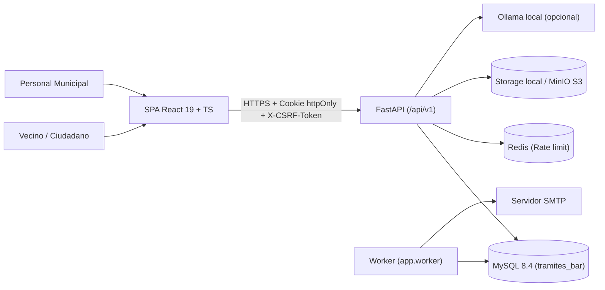

# Arquitectura Técnica — TramitesBAR

Este documento describe la arquitectura implementada en `sistema_licencias` (TramitesBAR), sus capas, contextos de dominio, ciclo de vida de las solicitudes y contrato de integración con el portal municipal SUBI (`guia-tramites-Baradero`).

---

## 1. Visión general y límites del módulo

TramitesBAR es el módulo municipal de licencias de conducir de Baradero. No reemplaza al portal general SUBI: funciona como un sistema autónomo dentro de `sistema_licencias/` con su propia API, modelo relacional y SPA, preparado para integrarse a SUBI mediante contrato HTTP y sesión compartible.

---

## 2. Capas del sistema

### 2.1 Presentación (`sistema_licencias/frontend/`)
- **Stack:** React 19, TypeScript, Vite, React Router 7, CSS institucional propio.
- **Estado de sesión:** gestionado por `AuthProvider` (`src/auth/AuthContext.tsx`) contra `/api/v1/auth/me`. No almacena tokens de sesión en `localStorage` ni `sessionStorage`.
- **Protección CSRF:** el cliente HTTP (`src/api/client.ts`) lee la cookie legible `tb_csrf` (o el token devuelto en `/api/v1/auth/me`) y la envía en la cabecera `X-CSRF-Token` en toda solicitud `POST`, `PATCH`, `PUT` o `DELETE`.
- **Restricciones de interfaz:** cero handlers inline, cero estilos inline, cero uso de `innerHTML` con datos de usuario y cero emojis (únicamente iconografía SVG en `src/components/Icons.tsx`).

### 2.2 Borde HTTP y Middlewares (`sistema_licencias/backend/app/main.py`)
- **Validación de arranque (`lifespan`):** ejecuta `settings.validate_runtime()` y `settings.ensure_directories()`. Si falta una clave criptográfica o si en producción hay parámetros inseguros, el proceso aborta antes de abrir el socket.
- **`SecurityHeadersMiddleware`:** asigna `X-Request-ID` a cada solicitud y respuesta, inyecta `Content-Security-Policy`, `X-Content-Type-Options: nosniff`, `X-Frame-Options: DENY`, `Referrer-Policy`, `Permissions-Policy`, `Cross-Origin-Opener-Policy`, `Cross-Origin-Resource-Policy` y `Strict-Transport-Security` (en producción), y elimina la cabecera `server`.
- **`CORSMiddleware` y `TrustedHostMiddleware`:** restringen orígenes y cabeceras `Host` a las listas explícitas definidas en `CORS_ORIGINS` y `TRUSTED_HOSTS`.
- **Manejadores globales de errores (`app/core/errors.py`):** normalizan cualquier `HTTPException`, `RequestValidationError` o excepción no controlada al sobre JSON `{"error": {"code": "...", "message": "..."}}` sin filtrar trazas internas.

### 2.3 Servicios de dominio (`sistema_licencias/backend/app/services/`)
Toda la lógica de negocio vive en módulos de servicio desacoplados de las rutas FastAPI:

| Servicio | Archivo | Responsabilidad |
|---|---|---|
| Autenticación y sesiones | `app/services/auth.py` | Registro, verificación de email, login con Argon2id, bloqueo progresivo, sesiones opacas, enrolamiento y validación TOTP MFA, recuperación de contraseña. |
| Catálogo | `app/services/catalog.py` | Consulta de tipos de trámite (`procedure_types`), matriz configurable (`procedure_matrix`) y materiales viales (`learning_materials`). |
| Políticas legales | `app/services/policies.py` | Versionado de políticas, hash SHA-256 de contenido, control de políticas pendientes y registro inmutable de aceptación (`policy_acceptances`). |
| Trámites y máquina de estados | `app/services/procedures.py` | Creación de expedientes (`procedures`), avance secuencial de pasos (`procedure_steps`), carga y revisión de documentos, reserva y calificación de turnos prácticos, entrega y emisión de credencial. |
| Pagos y conciliación | `app/services/payments.py` | Revisión manual de pagos declarados, regla de doble control para montos iguales o superiores a `PAYMENT_SECOND_APPROVAL_THRESHOLD` e importación/conciliación de extractos CSV y XLSX. |
| Exámenes teóricos | `app/services/exams.py` | Gestión del banco de preguntas revisadas (`questions`), congelamiento de preguntas al iniciar un intento (`exam_attempts`), control de tiempo y corrección íntegra en el servidor. |
| Credenciales | `app/services/licenses.py` | Numeración correlativa (`license_counters`), emisión de credencial municipal (`licenses`), generación de QR SVG y verificación pública enmascarada. |
| Notificaciones y correo | `app/services/notifications.py` | Creación de avisos en el portal (`notifications`), encolado idempotente en `email_outbox`, envío por consola o SMTP con backoff exponencial y purga de sesiones/tokens vencidos. |
| Bari | `app/services/bari.py` | Asistente determinista acotado a licencias de conducir, sanitización de PII (`scrub_pii`), guía paso a paso por trámite e integración opcional con Ollama local con fallback automático. |
| Almacenamiento | `app/services/storage.py` | Validación de tamaño y tipo MIME real por magic bytes (`PDF`, `JPEG`, `PNG`, `WEBP`), cálculo de SHA-256 y persistencia en disco fuera del webroot (`local`) o en S3/MinIO (`s3`). |
| Auditoría | `app/services/audit.py` | Escritura transaccional en `audit_log` con cadena criptográfica (`prev_hash` -> `entry_hash`) y verificación completa de integridad. |

### 2.4 Persistencia (`sistema_licencias/backend/app/models/` y `alembic/`)
- **ORM:** SQLAlchemy 2 con tipado estricto (`Mapped[...]`).
- **Motor:** MySQL 8.4 con `InnoDB`, `utf8mb4` y `utf8mb4_unicode_ci`. En unit tests aislados se permite SQLite en memoria mediante `BigIntPK` (`BigInteger().with_variant(Integer, "sqlite")`).
- **Migraciones:** Alembic (`alembic/versions/`). Ningún cambio de esquema se aplica a mano.

---

## 3. Ciclo de vida de una solicitud autenticada

1. El navegador envía la solicitud a `/api/v1/...` incluyendo la cookie `tb_session` (`httpOnly`) y, si es una mutación (`POST`, `PATCH`, `PUT`, `DELETE`), la cabecera `X-CSRF-Token` y la cookie `tb_csrf`.
2. `SecurityHeadersMiddleware` asigna el `request_id` y lo inyecta en el contexto de logging (`request_id_var`).
3. Si la ruta tiene `rate_limit(...)`, `enforce_rate_limit` verifica la ventana deslizante en Redis (o en memoria en desarrollo/tests) por IP y clave de acción. Si supera el umbral, devuelve `429 Too Many Requests` con cabecera `Retry-After`.
4. La dependencia `current_session` (`app/api/deps.py`) calcula `SHA-256(tb_session)` y busca la fila en `sessions`:
   - Rechaza con `401` si no existe, si `revoked_at` no es nulo o si `expires_at <= utcnow()`.
   - Rechaza con `401` (`session_idle`) y revoca la sesión si `last_seen_at` superó `SESSION_IDLE_MINUTES`.
   - Rechaza con `403` (`account_inactive`) si el usuario no está en estado `active`.
   - Actualiza `last_seen_at` si pasaron más de 5 minutos desde la última marca.
5. En métodos mutantes, `current_user` ejecuta `_verify_csrf`: compara en tiempo constante la cabecera `X-CSRF-Token` con la cookie `tb_csrf` y su hash `SHA-256` contra `session.csrf_hash`.
6. Si la ruta exige un permiso administrativo (`require_permission("...")` o `require_staff`), verifica el mapa fijo `ROLE_PERMISSIONS` (`app/core/permissions.py`) y exige que `user.mfa_enabled` sea `True`.
7. El servicio ejecuta la operación de negocio y registra el evento en `audit_log` dentro de la misma transacción SQL (`db.flush()` + `db.commit()`).

---

## 4. Worker de correo y mantenimiento (`app.worker`)

El módulo `app/worker.py` corre como proceso independiente de la API para que la latencia o caída de un servidor SMTP nunca bloquee las transacciones HTTP:

- Consulta `email_outbox` buscando filas en estado `pending` con `available_at <= utcnow()`.
- En MySQL utiliza `FOR UPDATE SKIP LOCKED` para permitir múltiples instancias del worker sin duplicar envíos.
- Si el envío falla, incrementa `attempts`, guarda el error en `last_error` y reprograma `available_at` con backoff (`2^attempts` minutos, hasta pasar a `failed` tras 5 intentos).
- Cada `MAINTENANCE_INTERVAL_MINUTES` ejecuta `purge_expired(db)` para limpiar tokens de un solo uso y sesiones antiguas vencidas.

---

## 5. Feature Flags de capacidades con dependencia externa

En `app/core/config.py` existen tres banderas desactivadas por defecto (`false`) que gobiernan funciones sujetas a validación legal o infraestructura dedicada:

| Variable | Estado por defecto | Propósito y condición de activación |
|---|---|---|
| `FEATURES_MINORS` | `false` | Habilita el inicio de trámites online para personas de 16 y 17 años con autorización digital de tutor (`guardian_consents`). Mientras sea `false`, la API rechaza trámites de menores indicando atención presencial con tutor legal. Requiere dictamen legal municipal antes de activarse. |
| `FEATURES_PROCTORING` | `false` | Habilita el examen supervisado en vivo mediante LiveKit + coturn. En v1 el examen teórico se rinde con validación e integridad del lado del servidor (ver [`docs/PROCTORING.md`](PROCTORING.md)). |
| `FEATURES_DNI_OCR` | `false` | Habilita la lectura automática de PDF417 y comparación biométrica de DNI. Requiere lote de pruebas anonimizadas y validación de retención de 90 días. |

---

## 6. Contrato de integración con SUBI

TramitesBAR se integra a `guia-tramites-Baradero` (SUBI) respetando estas fronteras:

1. **Prefijo de API aislado:** todos los endpoints de negocio viven bajo `/api/v1/*` y los chequeos de orquestación en `/health` y `/health/ready`.
2. **Base de datos dedicada:** usa el esquema `tramites_bar` con el usuario `tramites_app` sin acoplarse a tablas internas de otros trámites municipales.
3. **Montaje de frontend:** la SPA React puede servirse en su propio subdominio o bajo una ruta dedicada del proxy inverso municipal, comunicándose con FastAPI mediante cookies `SameSite=Lax` (o `Strict`) sobre HTTPS.
