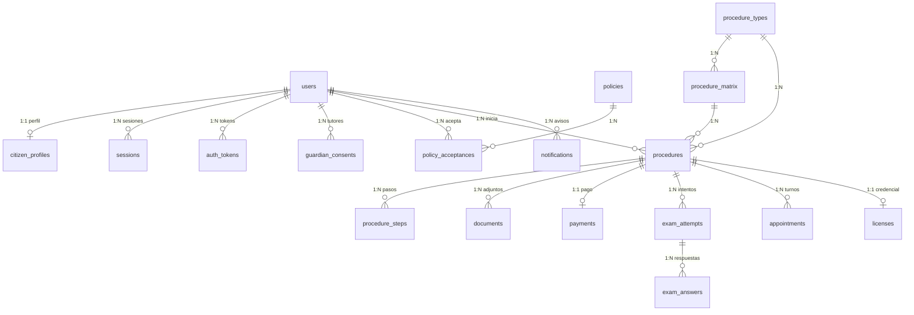

# Modelo de Datos — TramitesBAR

Este documento detalla el esquema relacional implementado en SQLAlchemy 2 (`sistema_licencias/backend/app/models/`) y gestionado con Alembic (`alembic/versions/d16e0434e5fd_esquema_inicial.py`).

---

## 1. Convenciones generales

- **Motor y juego de caracteres:** MySQL 8.4, motor `InnoDB`, charset `utf8mb4` y colación `utf8mb4_unicode_ci`.
- **Claves primarias:** enteros de 64 bits autoincrementales (`BigIntPK`), salvo tablas de catálogo por clave natural (`settings.key`, `license_counters.name`) y relación 1:1 en `citizen_profiles.user_id`.
- **Fechas y horas:** todas las columnas `DateTime` se almacenan en UTC sin zona horaria (`utcnow()`).
- **Integridad referencial:** todas las relaciones usan claves foráneas explícitas (`ON DELETE RESTRICT`, `CASCADE` o `SET NULL` según el ciclo de vida del dato).
- **Prohibición de datos de tarjeta:** ninguna tabla almacena números de tarjeta, CVV ni vencimientos. El pago es exclusivamente por transferencia bancaria y conciliación.

---

## 2. Diagrama Entidad-Relación



---

## 3. Diccionario de tablas

### 3.1 Identidad, sesiones y consentimientos (`app/models/user.py`)

#### `users`
Cuentas tanto de ciudadanos como de personal municipal.

| Columna | Tipo | Nulo | Índices / Constraints | Descripción |
|---|---|---|---|---|
| `id` | `BIGINT` | No | `PK`, autoincremental | Identificador interno del usuario. |
| `email` | `VARCHAR(255)` | No | `UNIQUE`, `ix_users_email` | Correo electrónico normalizado en minúsculas. |
| `password_hash` | `VARCHAR(255)` | No | — | Hash Argon2id (`m=64 MiB`, `t=3`, `p=4`). |
| `role` | `VARCHAR(32)` | No | `ix_users_role` | Rol (`citizen`, `admin_pagos`, `admin_salud`, `admin_turnos`, `admin_cuentas`, `admin`, `superadmin`). |
| `status` | `VARCHAR(20)` | No | `ix_users_status` | Estado (`active`, `suspended`, `pending`). |
| `email_verified_at` | `DATETIME` | Sí | — | Fecha de confirmación del correo electrónico. |
| `mfa_secret_enc` | `TEXT` | Sí | — | Secreto TOTP activo cifrado con AES-256-GCM. |
| `mfa_pending_secret_enc` | `TEXT` | Sí | — | Secreto TOTP en proceso de enrolamiento cifrado con AES-256-GCM. |
| `mfa_enabled` | `BOOLEAN` | No | — | Indica si el segundo factor está activo. |
| `mfa_recovery_hashes` | `JSON` | Sí | — | Lista de hashes SHA-256 de códigos de recuperación de un solo uso. |
| `failed_login_count` | `INT` | No | — | Contador de intentos fallidos consecutivos. |
| `locked_until` | `DATETIME` | Sí | — | Fecha hasta la cual la cuenta permanece bloqueada temporalmente. |
| `last_login_at` | `DATETIME` | Sí | — | Fecha del último ingreso exitoso. |
| `created_at` / `updated_at` | `DATETIME` | No | — | Marcas de auditoría temporal. |

#### `citizen_profiles`
Datos filiatorios y de contacto del ciudadano.

| Columna | Tipo | Nulo | Índices / Constraints | Descripción |
|---|---|---|---|---|
| `user_id` | `BIGINT` | No | `PK`, `FK -> users.id (CASCADE)` | Relación 1:1 con `users`. |
| `first_name` | `VARCHAR(100)` | No | — | Nombre(s). |
| `last_name` | `VARCHAR(100)` | No | — | Apellido(s). |
| `dni_encrypted` | `TEXT` | No | — | DNI cifrado con AES-256-GCM (`v1.<key_id>.<payload>`). |
| `dni_hmac` | `VARCHAR(64)` | No | `UNIQUE`, `ix_citizen_profiles_dni_hmac` | Índice ciego HMAC-SHA-256 del DNI para búsquedas y unicidad sin exponer el número. |
| `birth_date` | `DATE` | No | — | Fecha de nacimiento (usada para validar edad mínima y máxima según la matriz). |
| `phone_encrypted` | `TEXT` | Sí | — | Teléfono cifrado con AES-256-GCM. |
| `address` | `VARCHAR(255)` | Sí | — | Domicilio declarado. |
| `locality` | `VARCHAR(100)` | No | — | Localidad (por defecto `Baradero`). |
| `created_at` / `updated_at` | `DATETIME` | No | — | Marcas de auditoría temporal. |

#### `sessions` (modelo `UserSession`)
Sesiones opacas del lado del servidor.

| Columna | Tipo | Nulo | Índices / Constraints | Descripción |
|---|---|---|---|---|
| `id` | `BIGINT` | No | `PK`, autoincremental | Identificador de sesión. |
| `user_id` | `BIGINT` | No | `FK -> users.id (CASCADE)`, `ix_sessions_user_id`, `ix_sessions_user_revoked` | Usuario dueño de la sesión. |
| `token_hash` | `VARCHAR(64)` | No | `UNIQUE`, `ix_sessions_token_hash` | Hash SHA-256 del token enviado en la cookie `tb_session`. |
| `csrf_hash` | `VARCHAR(64)` | No | — | Hash SHA-256 del token CSRF asociado a la sesión. |
| `ip` | `VARCHAR(64)` | Sí | — | Dirección IP al iniciar sesión. |
| `user_agent` | `VARCHAR(255)` | Sí | — | Agente de usuario truncado a 255 caracteres. |
| `created_at` | `DATETIME` | No | — | Inicio de la sesión. |
| `last_seen_at` | `DATETIME` | No | — | Última actividad registrada (controla el vencimiento por inactividad). |
| `expires_at` | `DATETIME` | No | `ix_sessions_expires_at` | Vencimiento absoluto de la sesión. |
| `revoked_at` | `DATETIME` | Sí | `ix_sessions_user_revoked` | Fecha de cierre o revocación explícita. |

#### `auth_tokens` (modelo `AuthToken`)
Tokens de un solo uso para verificación de correo (`verify_email`) y reseteo de clave (`reset_password`).

| Columna | Tipo | Nulo | Índices / Constraints | Descripción |
|---|---|---|---|---|
| `id` | `BIGINT` | No | `PK`, autoincremental | Identificador del token. |
| `user_id` | `BIGINT` | No | `FK -> users.id (CASCADE)`, `ix_auth_tokens_user_purpose` | Usuario destinatario. |
| `purpose` | `VARCHAR(30)` | No | `ix_auth_tokens_user_purpose` | Propósito (`verify_email`, `reset_password`). |
| `token_hash` | `VARCHAR(64)` | No | `UNIQUE`, `ix_auth_tokens_token_hash` | Hash SHA-256 del token enviado por correo. |
| `expires_at` | `DATETIME` | No | — | Fecha límite de validez. |
| `used_at` | `DATETIME` | Sí | — | Marca de consumo para garantizar un único uso. |
| `created_at` | `DATETIME` | No | — | Fecha de emisión. |

#### `guardian_consents` (modelo `GuardianConsent`)
Autorizaciones de padre, madre o tutor legal para menores de edad (gobernado por `FEATURES_MINORS`).

| Columna | Tipo | Nulo | Índices / Constraints | Descripción |
|---|---|---|---|---|
| `id` | `BIGINT` | No | `PK`, autoincremental | Identificador de autorización. |
| `user_id` | `BIGINT` | No | `FK -> users.id (CASCADE)`, `ix_guardian_consents_user_id` | Menor titular del trámite. |
| `guardian_name` | `VARCHAR(150)` | No | — | Nombre y apellido del tutor. |
| `guardian_dni_encrypted` | `TEXT` | No | — | DNI del tutor cifrado con AES-256-GCM. |
| `guardian_dni_hmac` | `VARCHAR(64)` | No | — | HMAC-SHA-256 del DNI del tutor. |
| `relationship` | `VARCHAR(60)` | No | — | Vínculo declarado. |
| `guardian_email_encrypted` / `guardian_phone_encrypted` | `TEXT` | Sí | — | Contacto del tutor cifrado con AES-256-GCM. |
| `status` | `VARCHAR(20)` | No | `ix_guardian_consents_status` | Estado (`pending`, `approved`, `rejected`). |
| `evidence_document_id` | `BIGINT` | Sí | — | Referencia al documento respaldatorio. |
| `accepted_at` / `ip` / `user_agent` | `DATETIME` / `VARCHAR` | No / Sí | — | Evidencia técnica del consentimiento. |
| `reviewed_by` / `reviewed_at` / `review_notes` | `BIGINT` / `DATETIME` / `TEXT` | Sí | — | Datos de revisión administrativa. |

---

### 3.2 Políticas versionadas (`app/models/policy.py`)

#### `policies`
Textos normativos y de privacidad versionados.

| Columna | Tipo | Nulo | Índices / Constraints | Descripción |
|---|---|---|---|---|
| `id` | `BIGINT` | No | `PK`, autoincremental | Identificador de versión de política. |
| `slug` | `VARCHAR(60)` | No | `ix_policies_slug`, `uq_policies_slug_version` | Identificador lógico (ej. `privacidad`, `terminos`, `declaracion-jurada`). |
| `title` | `VARCHAR(160)` | No | — | Título visible. |
| `version` | `INT` | No | `uq_policies_slug_version` | Número de versión correlativo por `slug`. |
| `body_md` | `TEXT` | No | — | Contenido íntegro en Markdown. |
| `content_hash` | `VARCHAR(64)` | No | — | Hash SHA-256 de `body_md`. |
| `mandatory` | `BOOLEAN` | No | — | Si es `true`, bloquea el inicio de trámites hasta su aceptación. |
| `applies_to` | `VARCHAR(30)` | No | — | Alcance (`all`, `citizen`, `staff`). |
| `effective_at` | `DATETIME` | No | — | Fecha de entrada en vigencia. |
| `active` | `BOOLEAN` | No | `ix_policies_active` | Indica si es la versión vigente del `slug`. |

#### `policy_acceptances`
Evidencia inmutable de aceptación por usuario y versión de política.

| Columna | Tipo | Nulo | Índices / Constraints | Descripción |
|---|---|---|---|---|
| `id` | `BIGINT` | No | `PK`, autoincremental | Identificador de aceptación. |
| `user_id` | `BIGINT` | No | `FK -> users.id (CASCADE)`, `uq_policy_acceptance_user_policy` | Usuario aceptante. |
| `policy_id` | `BIGINT` | No | `FK -> policies.id (RESTRICT)`, `uq_policy_acceptance_user_policy` | Versión exacta aceptada. |
| `content_hash` | `VARCHAR(64)` | No | — | Copia del hash SHA-256 del texto aceptado en ese instante. |
| `accepted_at` | `DATETIME` | No | — | Marca temporal UTC de aceptación. |
| `ip` / `user_agent` | `VARCHAR` | Sí | — | Metadatos de red de la aceptación. |

---

### 3.3 Catálogo, matriz y expedientes (`app/models/procedure.py`)

#### `procedure_types`
Los seis tipos de trámite municipales (`nueva`, `renovacion`, `vencida`, `categoria`, `profesional`, `extravio`).

| Columna | Tipo | Nulo | Índices / Constraints | Descripción |
|---|---|---|---|---|
| `id` | `BIGINT` | No | `PK` | Identificador interno. |
| `code` | `VARCHAR(30)` | No | `UNIQUE`, `ix_procedure_types_code` | Código estable usado en la API. |
| `name` | `VARCHAR(120)` | No | — | Nombre público del trámite. |
| `short_description` / `description` | `VARCHAR(255)` / `TEXT` | No | — | Descripciones breve y extendida. |
| `icon` / `sort_order` / `active` | `VARCHAR` / `INT` / `BOOL` | No | `ix_procedure_types_active` | Orden visual y estado de habilitación. |

#### `procedure_matrix`
Fuente de verdad configurable por combinación `(procedure_type_id, license_category)`.

| Columna | Tipo | Nulo | Índices / Constraints | Descripción |
|---|---|---|---|---|
| `id` | `BIGINT` | No | `PK` | Identificador de fila de matriz. |
| `procedure_type_id` | `BIGINT` | No | `FK -> procedure_types.id (CASCADE)`, `uq_matrix_type_category` | Tipo de trámite. |
| `license_category` | `VARCHAR(10)` | No | `uq_matrix_type_category` | Categoría (`A`, `B`, `C`, `D`, `E`, `G`). |
| `min_age` / `max_age` | `INT` | No / Sí | — | Rango etario permitido. |
| `fee_amount` | `NUMERIC(12,2)` | No | — | Arancel municipal en pesos argentinos. |
| `validity_years` | `INT` | No | — | Años de vigencia de la credencial resultante. |
| `steps` | `JSON` | No | — | Lista ordenada de códigos de paso (`charlas`, `health`, `theory`, `payment`, `practical`, `delivery`). |
| `required_documents` | `JSON` | No | — | Tipos de documento exigidos. |
| `theory_questions` / `theory_pass_ratio` / `theory_minutes` / `max_theory_attempts` | `INT` / `NUMERIC(4,2)` | No | — | Parámetros del examen teórico para esa categoría. |
| `requires_health` / `requires_practical` / `active` | `BOOLEAN` | No | `ix_procedure_matrix_active` | Banderas de exigencia médica, práctica y vigencia de la regla. |

#### `learning_materials`
Materiales educativos para el paso `charlas` (`code`, `title`, `description`, `kind`, `url`, `body_md`, `sort_order`, `active`).

#### `procedures`
Expediente iniciado por un ciudadano.

| Columna | Tipo | Nulo | Índices / Constraints | Descripción |
|---|---|---|---|---|
| `id` | `BIGINT` | No | `PK` | Identificador interno del expediente. |
| `public_code` | `VARCHAR(24)` | No | `UNIQUE`, `ix_procedures_public_code` | Código legible para el vecino (ej. `BAR-2026-...`). |
| `user_id` | `BIGINT` | No | `FK -> users.id (RESTRICT)`, `ix_procedures_user_status` | Ciudadano titular. |
| `procedure_type_id` / `matrix_id` | `BIGINT` | No | `FK (RESTRICT)` | Tipo de trámite y regla de matriz aplicada. |
| `license_category` | `VARCHAR(10)` | No | — | Categoría solicitada. |
| `status` | `VARCHAR(20)` | No | `ix_procedures_status` | Estado (`in_progress`, `under_review`, `completed`, `rejected`, `cancelled`). |
| `current_step` | `VARCHAR(30)` | Sí | — | Código del paso actualmente habilitado. |
| `data` | `JSON` | No | — | Datos adicionales del expediente (modalidad de entrega, autorizaciones de reintento). |
| `rejection_reason` | `TEXT` | Sí | — | Motivo en caso de rechazo administrativo. |
| `submitted_at` / `completed_at` | `DATETIME` | Sí | — | Fechas de envío y finalización. |

#### `procedure_steps`
Pasos instanciados para un expediente (`procedure_id`, `code`, `position`, `status`, `data`, `notes`, `completed_at`, `reviewed_by`, `review_notes`), con restricción única `uq_step_procedure_code` sobre `(procedure_id, code)`.

#### `documents`
Archivos subidos y validados (`procedure_id`, `user_id`, `kind`, `original_name`, `storage_key` único, `mime`, `size_bytes`, `sha256`, `status`, `review_notes`, `reviewed_by`, `reviewed_at`, `expires_at`).

#### `appointments`
Cupos y reservas para examen práctico (`procedure_id`, `kind`, `scheduled_at`, `location`, `capacity`, `status`, `instructor`, `result`, `notes`, `created_by`).

#### `license_counters`
Contador transaccional (`name`, `counter_value`) bloqueado con `FOR UPDATE` para emitir números de credencial correlativos sin colisiones.

---

### 3.4 Pagos y conciliación (`app/models/payment.py`)

#### `payments`
| Columna | Tipo | Nulo | Índices / Constraints | Descripción |
|---|---|---|---|---|
| `id` | `BIGINT` | No | `PK` | Identificador del pago. |
| `procedure_id` | `BIGINT` | No | `UNIQUE`, `FK -> procedures.id (CASCADE)` | Relación 1:1 con el expediente. |
| `user_id` | `BIGINT` | No | `FK -> users.id (RESTRICT)` | Ciudadano pagador. |
| `amount` | `NUMERIC(12,2)` | No | — | Monto congelado según la matriz al iniciar el trámite. |
| `reference` | `VARCHAR(40)` | No | `UNIQUE`, `ix_payments_reference` | Código único de transferencia (`PAGO-<public_code>`). |
| `method` | `VARCHAR(20)` | No | — | Método (`transfer`). |
| `status` | `VARCHAR(20)` | No | `ix_payments_status` | Estado (`pending`, `claimed`, `pending_second`, `approved`, `rejected`, `refunded`). |
| `receipt_document_id` | `BIGINT` | Sí | `FK -> documents.id (SET NULL)` | Comprobante subido por el ciudadano. |
| `payer_name` / `payer_dni_masked` / `transfer_date` / `claimed_at` | Varios | Sí | — | Datos declarados de la transferencia (el DNI del ordenante se guarda enmascarado `***123`). |
| `reviewed_by` / `second_reviewed_by` / `reviewed_at` / `review_notes` | Varios | Sí | — | Trazabilidad de primera y segunda aprobación (doble control). |

#### `payment_imports`
Auditoría de importaciones de extractos bancarios CSV/XLSX (`id`, `filename`, `total_rows`, `matched_rows`, `exception_rows`, `imported_by`, `details` JSON con la lista de excepciones detectadas, `created_at`).

---

### 3.5 Exámenes teóricos (`app/models/exam.py`)

- **`questions`:** banco de preguntas por categoría (`id`, `category`, `prompt`, `options` JSON, `correct_index`, `explanation`, `active`, `reviewed`, `source`). Solo las filas con `active = true` y `reviewed = true` entran en los sorteos de examen.
- **`exam_attempts`:** intento de un ciudadano (`id`, `procedure_id`, `user_id`, `attempt_number`, `status`, `questions` JSON con el snapshot congelado de preguntas y opciones correctas en servidor, `score`, `total`, `started_at`, `expires_at`, `submitted_at`).
- **`exam_answers`:** respuestas individuales corregidas en el servidor (`id`, `attempt_id`, `question_index`, `selected_index`, `correct`).

---

### 3.6 Credenciales, notificaciones y auditoría (`license.py`, `notification.py`, `audit.py`)

- **`licenses`:** credencial municipal emitida (`id`, `procedure_id` único, `user_id`, `license_number` único, `category`, `issued_at`, `expires_at`, `status`, `qr_token` único de 256 bits en hex, `revoked_at`, `revocation_reason`).
- **`notifications`:** bandeja interna del usuario (`id`, `user_id`, `title`, `body`, `link`, `read_at`, `created_at`).
- **`email_outbox`:** cola transaccional de salida (`id`, `to_email`, `subject`, `body_text`, `body_html`, `template`, `status`, `attempts`, `last_error`, `available_at`, `sent_at`, `idempotency_key` única, `payload` JSON, `created_at`).
- **`audit_log`:** bitácora inmutable encadenada por hash (`id`, `actor_user_id`, `actor_role`, `action`, `entity_type`, `entity_id`, `before` JSON, `after` JSON, `ip`, `user_agent`, `created_at`, `prev_hash`, `entry_hash`).
- **`settings`:** parámetros operativos editables (`key` PK, `value` JSON, `updated_by`).

---

## 4. Gestión de migraciones con Alembic

Desde `sistema_licencias/backend`:

```bash
# Aplicar todas las migraciones pendientes
alembic upgrade head

# Verificar revisión actual
alembic current

# Crear una nueva migración tras modificar modelos
alembic revision --autogenerate -m "descripcion_del_cambio"

# Probar reversibilidad (solo en desarrollo / CI)
alembic downgrade -1
alembic upgrade head
```

Nunca se edita una migración que ya fue corrida en entornos compartidos; cualquier ajuste posterior se hace mediante una nueva revisión lineal.
