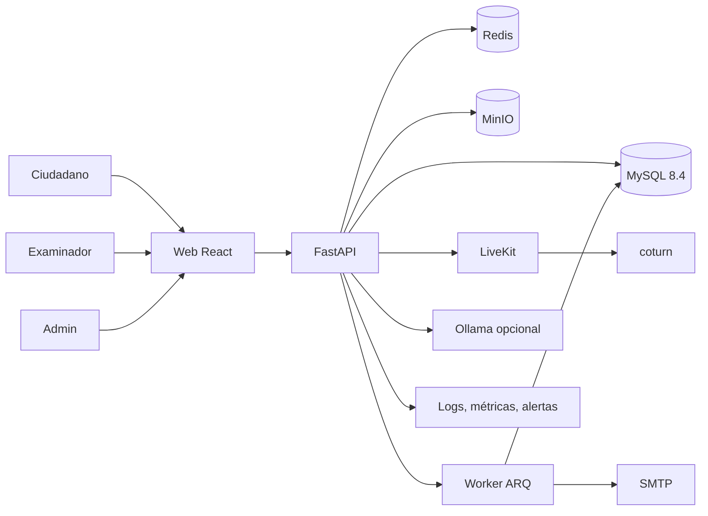

# Plan Maestro — TramitesBAR

Versión: 1.0
Fecha: 2026-11-02
Estado: aprobado para implementación
Alcance: `sistema_licencias` (TramitesBAR)
Destino final: módulo importable dentro de SUBI (`guia-tramites-Baradero`)

---

## 0. Cómo se usa este documento

Este es el documento canónico. Si el código y este plan no coinciden, se frena y se pregunta. No se inventa nada.

- Las decisiones cerradas están en `DECISIONES.md`.
- Las reglas para ramas y merges están en `GUIA_RAMAS_Y_MERGE.md`.
- Las reglas para humanos y agentes están en `AGENTS.md`.
- El contexto histórico está en `tramitesbar-context.md`.

Cuando este documento se copie al repositorio, va en `docs/plan/PLAN_MAESTRO.md`. La copia del repositorio es la que leen todas las ramas.

---

## 1. Resumen ejecutivo

TramitesBAR es el sistema municipal de licencias de conducir de Baradero. No es SUBI. SUBI es el portal municipal grande; TramitesBAR es el módulo de licencias que después se importa a SUBI.

El objetivo es reemplazar el prototipo actual por un sistema real, seguro, relacional y escalable:

- FastAPI + SQLAlchemy + MySQL 8.4 en el backend.
- React + TypeScript en el frontend.
- LiveKit para el examen supervisado en vivo.
- Bari como guía visual y asistente limitado al dominio de licencias.
- Políticas de privacidad y seguridad obligatorias.
- Pagos por transferencia con conciliación manual.
- Notificaciones por correo y dentro del portal.
- Evidencia de incidentes para respaldar expulsiones y apelaciones.
- SOC 2 readiness desde el día uno y SOC 2 Type II después de operar.

La regla más importante: **nada de demo, nada de datos falsos en producción, nada de fallbacks que oculten errores, nada de `admin123`**.

---

## 2. Alcance

### 2.1 Entra

- Todo lo que está dentro de `sistema_licencias`: backend, frontend y base de datos.
- Los seis tipos de trámite: `nueva`, `renovacion`, `vencida`, `categoria`, `profesional`, `extravio`/robo.
- Matriz configurable de requisitos, aranceles, vigencias y exámenes.
- Pagos por transferencia, comprobantes, importación de extractos y conciliación.
- Examen teórico, banco de preguntas, intentos y resultados.
- Proctoring en vivo con cámara, micrófono, pantalla, escaneo 360 y consola de examinador.
- Evidencia de incidentes y apelaciones.
- Credencial digital municipal con QR y verificación pública.
- Políticas versionadas, consentimiento informado y autorización de tutor para menores.
- Notificaciones por correo y en el portal.
- Bari, guía visual y bot restringido a licencias.
- Lector de DNI, PDF417, rostro y validaciones.
- Backoffice de administración, pagos, exámenes, examinadores y auditoría.
- Manual y curso de capacitación para examinadores.

### 2.2 No entra

- El núcleo de SUBI ni los demás trámites municipales.
- Emisión de licencia nacional oficial. Hasta dictamen legal, es una credencial municipal.
- Pagos con tarjeta.
- Scraping de home banking.
- Grabación local por parte de examinadores.
- Aplicaciones móviles nativas. La web es responsive; el examen es desktop-only.
- Datos sintéticos o modos demo en producción.

### 2.3 Integración futura con SUBI

TramitesBAR se construye como módulo con API y esquemas compartidos. La integración final se hace dentro de `guia-tramites-Baradero`, reutilizando autenticación, navegación y diseño cuando sea posible. El módulo no depende de SUBI para funcionar solo.

---

## 3. Decisiones cerradas

| Tema | Decisión |
|---|---|
| Alcance SOC 2 | Solo `sistema_licencias` y sus dependencias. SUBI queda afuera. |
| SOC 2 | Readiness desde el día uno y Type II real después de 3 a 6 meses de operación. Auditores disponibles. |
| SOC 1 | No aplica al sistema. Se evalúa solo si el municipio lo exige por los pagos. |
| Grabación | Opción B: clip de incidente de 60 a 120 segundos, del lado del servidor, cifrado, retención de 90 días. Sin grabación local por examinadores. |
| Stack backend | FastAPI + SQLAlchemy 2 + Alembic + Pydantic v2 + MySQL 8.4. |
| Stack frontend | React 19 + TypeScript + Vite + TanStack Query + React Router + Zod + Radix + CSS propio. |
| Base de datos | MySQL 8.4.7 en WAMP puerto 3306 para desarrollo. Base `tramites_bar`, usuario `tramites_app`. |
| Tests | SQLite solo para unitarios aislados. Integración con MySQL real en Docker. |
| Auth | Argon2id, sesión opaca en cookie `httpOnly`, `Secure`, `SameSite`, CSRF, MFA TOTP para staff. |
| Criptografía | AES-256-GCM para datos sensibles, HMAC-SHA-256 para índice ciego, TLS 1.3. |
| Proctoring | LiveKit self-hosted + coturn. Máximo 5 alumnos por examinador. 10+ examinadores. |
| Evidencia | Eventos técnicos + informe firmado del examinador + clip de incidente. |
| Bari | Guía visual + bot determinista. Ollama local opcional. Sin API externa como dependencia crítica. |
| Correo | Gmail para desarrollo. SMTP oficial o proveedor transaccional para producción. |
| Pagos | Transferencia, código de referencia, comprobante, CSV/XLSX, conciliación, excepciones, doble control. |
| Retención | 5 años licencias y pagos; 2 años eventos de examen; 90 días imágenes de DNI; 10 años aceptaciones; 90 días clips de incidente. |
| Plataforma | Código cross-platform. Desarrollo Windows con WAMP. Producción Linux con Docker. LiveKit siempre en Docker. |
| Comentarios | Docstring por función, comentario por bloque y comentario de línea en módulos críticos. |
| Examinadores | Personal municipal, registro formal, certificación obligatoria, máximo 5 alumnos, manual y curso. |

---

## 4. Arquitectura

### 4.1 Diagrama

### 4.2 Capas

- **Presentación:** React + TypeScript. Consume la API por HTTPS. No guarda tokens en `localStorage`.
- **API:** FastAPI. Validación con Pydantic. OpenAPI generado. Errores RFC 7807.
- **Dominio:** servicios por módulo, sin lógica de negocio en los controladores.
- **Persistencia:** SQLAlchemy 2 con repositorios. Migraciones Alembic. MySQL con InnoDB, `utf8mb4` y claves foráneas.
- **Asincronía:** Redis + ARQ para correos, importaciones, retención y tareas pesadas.
- **Tiempo real:** LiveKit para audio, video y pantalla. WebSocket o SSE para eventos de proctoring y notificaciones.
- **Archivos:** MinIO con URLs firmadas y cifrado en reposo.
- **Observabilidad:** logs JSON, Prometheus, Grafana, Sentry y auditoría separada.

### 4.3 Módulos del backend

| Módulo | Responsabilidad |
|---|---|
| `auth` | Login, logout, sesiones, MFA, recuperación, verificación de email. |
| `users` | Ciudadanos, staff, perfiles, roles y permisos. |
| `policies` | Políticas versionadas, aceptación y consentimiento de tutor. |
| `procedures` | Matriz, trámites, estados, requisitos, documentos y turnos. |
| `payments` | Aranceles, referencias, comprobantes, importación y conciliación. |
| `exams` | Banco de preguntas, intentos, scoring y resultados. |
| `proctoring` | Salas, participantes, eventos, incidentes, evidencia y expulsiones. |
| `notifications` | Outbox, correo, notificaciones internas y preferencias. |
| `credentials` | Licencias, QR, verificación pública, revocación y vencimiento. |
| `bari` | Guía visual, bot determinista, Ollama y base de conocimiento. |
| `audit` | Registro inmutable, consultas y exportación. |
| `admin` | Backoffice, reportes, configuración y salud del sistema. |

### 4.4 Frontend

- **Público:** inicio, catálogo de trámites, requisitos, aranceles, verificación de licencia, políticas y Bari.
- **Ciudadano:** panel, perfil, trámites, documentos, pagos, turnos, examen, notificaciones, apelaciones y credencial.
- **Examinador:** login con MFA, sesiones asignadas, pre-examen, consola en vivo, incidentes e historial.
- **Admin:** usuarios, roles, matriz, aranceles, preguntas, turnos, examinadores, pagos, excepciones, reportes, auditoría y configuración.
- **Superadmin:** seguridad, integraciones, claves, respaldos y exportación de auditoría.

Reglas de frontend:

- Cero handlers inline.
- Cero estilos inline.
- Cero `innerHTML` con datos del usuario.
- Cero emojis. Iconos SVG.
- Componentes accesibles, foco visible, navegación por teclado.
- WCAG 2.1 AA.
- `prefers-reduced-motion` para Bari y animaciones.
- Textos en español rioplatense, claros, sin jerga innecesaria.

---

## 5. Modelo de datos

Entidades principales. El diccionario completo va en `docs/MODELO_DATOS.md`.

| Entidad | Para qué |
|---|---|
| `users` | Cuenta, email, hash de contraseña, rol, estado, MFA. |
| `citizen_profiles` | Datos personales, DNI cifrado, índice ciego, nacimiento, domicilio. |
| `guardian_consents` | Tutor, parentesco, autorización, evidencia y vigencia. |
| `roles`, `permissions`, `role_permissions` | RBAC. |
| `sessions` | Sesión opaca, hash del token, CSRF, IP, user agent, expiración. |
| `mfa_credentials` | TOTP cifrado, códigos de recuperación hasheados. |
| `policies` | Tipo, versión, hash, vigencia y estado. |
| `policy_acceptances` | Usuario, política, fecha, IP, user agent y hash. |
| `procedure_types` | Tipo de trámite y descripción. |
| `procedure_matrix` | Requisitos, categoría, edad, arancel, vigencia, examen, salud. |
| `procedures` | Trámite, ciudadano, tipo, estado, paso actual y código de referencia. |
| `procedure_steps` | Paso, estado, fechas y datos del formulario. |
| `documents` | Archivo, tipo, hash, estado, revisión y borrado. |
| `appointments` | Turno, fecha, lugar, capacidad y estado. |
| `payments` | Monto, referencia, comprobante, estado y conciliación. |
| `payment_imports` | Archivo importado, filas, coincidencias y errores. |
| `payment_exceptions` | Sobrepago, subpago, duplicado, desconocido y devolución. |
| `questions`, `question_options` | Banco de preguntas y opciones. |
| `exam_sessions` | Intento, ciudadano, examinador, estado, puntaje y resultado. |
| `exam_answers` | Respuesta, corrección y puntaje. |
| `exam_incidents` | Tipo, severidad, fecha, motivo, nota y decisión. |
| `exam_evidence` | Clip, hash, cifrado, retención y acceso. |
| `examiner_profiles` | Legajo, área, estado y máximo de alumnos. |
| `examiner_certifications` | Curso, fecha, vencimiento y resultado. |
| `examiner_assignments` | Examinador asignado a sesión. |
| `licenses` | Credencial, categoría, emisión, vencimiento, QR y estado. |
| `notifications` | Notificación interna, leída y fecha. |
| `email_outbox` | Cola de correo, plantilla, estado, intentos e idempotencia. |
| `audit_log` | Actor, acción, entidad, antes/después, IP, hash y cadena. |
| `settings` | Configuración cifrada y auditable. |

Reglas:

- Claves primarias UUID o enteros grandes, consistentes.
- `created_at`, `updated_at` y `deleted_at` solo cuando haga falta.
- Nada de borrado físico de auditoría.
- Índices en DNI ciego, email, referencia de pago, estado y fechas.
- Claves foráneas con `ON DELETE RESTRICT` por defecto.
- Migraciones lineales. No se edita una migración ya aplicada.

---

## 6. Seguridad y cumplimiento

### 6.1 Estándares

- OWASP ASVS 4.0.3 Level 2.
- OWASP Top 10.
- OWASP API Security Top 10.
- Ley 25.326 de Protección de Datos Personales.
- SOC 2 Trust Services Criteria: Security, Availability, Processing Integrity, Confidentiality y Privacy.
- CIS Controls como referencia de hardening.

### 6.2 Autenticación

- Contraseñas con Argon2id: `m=64 MiB`, `t=3`, `p=4`.
- Sal única por usuario.
- Rehash automático al login si cambian los parámetros.
- Comparación en tiempo constante.
- Verificación de email obligatoria.
- Recuperación con token de 256 bits, hash SHA-256 en base, un solo uso y vencimiento corto.
- MFA TOTP obligatorio para admin, examinador, pagos y superadmin.
- Códigos de recuperación hasheados.
- Bloqueo progresivo por intentos fallidos.
- No revelar si un email existe.

### 6.3 Criptografía

- Datos sensibles: AES-256-GCM con clave maestra fuera de la base.
- Cada cifrado guarda `key_id`, `nonce` y `tag`.
- Índice ciego de DNI: HMAC-SHA-256 con clave separada.
- Integridad de archivos y auditoría: SHA-256 y HMAC-SHA-256.
- TLS 1.3, HSTS, redirección de HTTP a HTTPS.
- Tokens de sesión: 256 bits aleatorios, hash SHA-256 en base.
- Rotación de claves con job de re-cifrado.
- Prohibido usar SHA-256 para contraseñas, Base64 como cifrado o claves en el código.

### 6.4 Sesiones y CSRF

- Cookie `httpOnly`, `Secure`, `SameSite=Lax` para ciudadano y `Strict` para staff.
- Sesión opaca del lado del servidor.
- Rotación al login y al cambiar privilegios.
- Expiración por inactividad y absoluta.
- Revocación individual y global.
- CSRF con token ligado a la sesión, validado en cada mutación.
- Logout invalida la sesión y borra la cookie.

### 6.5 Rate limiting

Redis con ventana deslizante por IP, cuenta y endpoint:

- Login: 5 por minuto por IP y 10 por cuenta cada 15 minutos.
- Recuperación: 3 por hora.
- MFA: 5 intentos cada 10 minutos.
- Registro: 3 por hora por IP.
- DNI: 10 por minuto.
- Pagos: 20 por minuto.
- Eventos de proctoring: 30 por minuto por sesión.
- Verificación pública de licencia: 30 por minuto.
- API general: 100 por minuto por usuario.

Respuesta `429` con `Retry-After`. Logs sin PII.

### 6.6 Autorización

- RBAC con permisos por recurso y acción.
- Verificación de propiedad en cada recurso del ciudadano.
- Tests de IDOR para cada endpoint.
- Los roles no se confían desde el cliente.
- Admin y examinador no pueden leer datos que no les corresponden.
- Superadmin con break-glass auditado.

### 6.7 Entradas y salidas

- Validación con Pydantic en el borde.
- ORM con consultas parametrizadas.
- Escape automático de React y CSP estricta.
- Límite de tamaño y profundidad de JSON.
- Validación de MIME real, no solo extensión.
- Re-encodeo de imágenes.
- Sanitización de PDF.
- URLs firmadas y expiración corta.
- Protección SSRF en descargas y webhooks.
- Cabeceras: CSP, HSTS, `X-Content-Type-Options`, `Referrer-Policy`, `Permissions-Policy`.

### 6.8 Archivos

- Subida a MinIO, fuera del webroot.
- ClamAV o antivirus equivalente.
- Límite de 10 MB por archivo, configurable.
- Nombre aleatorio, nunca el original.
- Hash SHA-256 para integridad.
- Cifrado en reposo.
- Borrado lógico y físico según retención.
- URLs firmadas de 5 minutos.
- Registro de quién descargó qué.

### 6.9 Secretos

- `.env` solo en desarrollo, nunca en git.
- Producción con Docker secrets, systemd credentials o Vault.
- Claves separadas por función: sesión, cifrado, HMAC, SMTP, LiveKit.
- Rotación documentada.
- Escaneo de secretos en CI con gitleaks.

### 6.10 Auditoría

- Tabla `audit_log` append-only.
- Cadena de hashes para detectar alteraciones.
- Anclaje periódico a almacenamiento WORM o S3 Object Lock.
- Registra actor, acción, entidad, valores anteriores y nuevos, IP, user agent y fecha.
- Exportación para auditoría.
- Retención de 5 años.
- Acceso de solo lectura para auditoría.

### 6.11 Backups

- MySQL: dump cifrado diario y binlogs.
- MinIO: versionado y replicación.
- Claves de backup separadas.
- Prueba de restauración trimestral.
- RPO 15 minutos, RTO 4 horas.
- Backups fuera del servidor principal.

### 6.12 Respuesta a incidentes

- Roles, severidades y plazos.
- Runbook en `docs/INCIDENT_RESPONSE.md`.
- Notificación legal según Ley 25.326.
- Postmortem sin culpa.
- Evidencia preservada.
- Simulacro semestral.

### 6.13 Proveedores

- LiveKit self-hosted: sin tercero de video.
- SMTP: revisar contrato, privacidad y retención.
- Hosting: revisar SOC 2 del proveedor.
- Auditor: independencia y alcance.
- Registro de proveedores y revisiones anuales.

### 6.14 SOC 2

Controles desde el día uno:

- Gestión de accesos y revisiones trimestrales.
- MFA y mínimo privilegio.
- Gestión de cambios con PR, revisión y CI.
- Gestión de vulnerabilidades y parches.
- Monitoreo, alertas y respuesta a incidentes.
- Backups y continuidad.
- Gestión de proveedores.
- Capacitación del personal.
- Registro de riesgos.
- Políticas aprobadas y versionadas.
- Evidencia automatizada y capturas cuando haga falta.

El Type II se audita después de 3 a 6 meses de operación real. No se puede emitir antes.

---

## 7. Flujos funcionales

### 7.1 Trámite

1. El ciudadano se registra, verifica email y acepta políticas.
2. Si es menor, se registra el tutor y su autorización.
3. Elige tipo de trámite. La matriz calcula requisitos, arancel y vigencia.
4. Completa datos y sube documentos.
5. El sistema valida y deriva a pago, salud, curso o examen según la matriz.
6. Cada paso completado genera notificación y correo.
7. Un admin revisa documentos y pagos.
8. Se agenda el examen y el turno práctico.
9. Se emite la credencial.
10. Todo cambio de estado queda auditado.

### 7.2 Pago

1. El sistema genera un código de referencia único.
2. El ciudadano transfiere y sube comprobante.
3. El admin importa el extracto CSV/XLSX.
4. El motor concilia por referencia, monto, DNI, nombre y fecha.
5. Las coincidencias exactas se aprueban según regla.
6. Las dudosas van a la cola de excepciones.
7. Montos altos requieren doble control.
8. Se notifica al ciudadano.
9. Todo queda auditado.

### 7.3 Examen

1. El ciudadano paga el examen y queda habilitado.
2. Elige turno disponible.
3. Se le asigna un examinador con cupo.
4. Hace el pre-examen.
5. El examinador lo admite.
6. Responde el examen. El puntaje se calcula en el servidor.
7. Si aprueba, avanza. Si desaprueba, paga de nuevo y espera autorización.
8. Si hay incidente, se registra evidencia y se decide.
9. Puede apelar.

### 7.4 Proctoring

**Pre-examen:**

- Desktop con Chrome o Edge.
- Cámara y micrófono obligatorios.
- Compartir pantalla obligatorio.
- Escaneo 360 del entorno.
- Mostrar escritorio, arriba y abajo del escritorio.
- Mostrar DNI.
- Selfie.
- Secuencia aleatoria de movimientos.
- Aceptación de reglas y consentimiento de evidencia.
- Sala de espera.

**En vivo:**

- Un room de LiveKit por sesión.
- El alumno publica cámara y pantalla.
- El examinador ve hasta 5 alumnos.
- Grilla grande; click para enfocar uno.
- Alertas por alt-tab, cambio de pestaña, cámara apagada, pérdida de pantalla, rostro ausente, múltiples rostros, ruido, salida de fullscreen y caída de red.
- El examinador puede advertir, marcar incidente, pedir nuevo escaneo o expulsar.
- La expulsión requiere motivo y genera evidencia.
- La decisión final es humana.

**Capacidad:**

- 10+ examinadores.
- 5 alumnos por examinador.
- 50+ sesiones concurrentes.
- Servidor con 16+ vCPU, 32 GB RAM, 1 Gbps simétrico, IP pública y TURN.

### 7.5 Evidencia (Opción B)

- El servidor mantiene un buffer de 60 a 120 segundos por sesión.
- Cuando hay incidente o expulsión, se preserva el clip.
- Se cifra con AES-256-GCM.
- Se guarda en MinIO con hash y metadatos.
- Retención de 90 días.
- Acceso solo para revisores de apelación.
- Cada acceso queda auditado.
- No hay grabación local por parte del examinador.
- No hay botón de descarga en la consola.
- Si el clip falla, quedan los eventos y el informe firmado.

### 7.6 Apelación

1. El ciudadano recibe el motivo y puede apelar.
2. Se abre un expediente con eventos, informe y clip.
3. Un revisor distinto del examinador decide.
4. Se registra la decisión, el fundamento y la fecha.
5. Se notifica al ciudadano.
6. Si se revoca la expulsión, se habilita nuevo intento sin costo o con costo según regla.
7. Todo auditado.

### 7.7 Credencial

- Se emite al aprobar todas las etapas.
- Incluye categoría, vigencia, QR y número de credencial.
- Verificación pública por QR.
- Revocación inmediata.
- Renovación y vencimiento.
- No se presenta como licencia nacional oficial hasta dictamen legal.

### 7.8 Notificaciones

Eventos mínimos:

- Trámite iniciado.
- Sección completada.
- Documento aprobado o rechazado.
- Pago recibido, aprobado o rechazado.
- Examen programado.
- Recordatorio 48 h, 24 h y 2 h antes.
- Admisión al examen.
- Expulsión o incidente.
- Resultado del examen.
- Reintento habilitado.
- Apelación resuelta.
- Licencia emitida.
- Licencia por vencer.
- Cambio de contraseña, MFA o dispositivo.

Canales: correo y notificación interna. Cola con reintentos, idempotencia y registro de entrega.

### 7.9 Bari

- Guía visual por paso con videos y tips.
- Bot determinista para preguntas frecuentes.
- Ollama local opcional para preguntas libres.
- Base de conocimiento con documentación oficial.
- Restricción estricta a licencias.
- Si no sabe, deriva; no inventa.
- Sin PII en prompts.
- Si Ollama falla, sigue el determinista.

### 7.10 DNI

- PDF417 del dorso.
- Validación de apellido, nombre, sexo, DNI, ejemplar, nacimiento, emisión y código.
- Detección de rostro real.
- Comparación con selfie para revisión humana.
- Duplicados por índice ciego.
- Imágenes cifradas.
- Borrado a los 90 días.
- Fixtures anonimizados para tests.

### 7.11 Menores

- El sistema detecta edad.
- Exige tutor registrado y verificado.
- El tutor acepta políticas y monitoreo.
- Se guarda parentesco, evidencia, fecha, IP y hash.
- Sin tutor no se avanza.
- Alternativa presencial disponible.
- Revisión legal obligatoria antes de producción.

### 7.12 Examinadores

- Registro formal con legajo y área.
- Certificación obligatoria.
- Máximo 5 alumnos concurrentes.
- Asignación desde el backoffice.
- Solo examinadores activos y certificados.
- Manual y curso aprobados.
- Recertificación anual.
- Registro de sesiones, expulsiones y apelaciones.

---

## 8. Infraestructura y despliegue

### 8.1 Desarrollo Windows

- Python 3.13.
- WAMP con MySQL 8.4 en 3306.
- Docker Desktop o WSL2 para LiveKit, coturn, Redis y MinIO.
- `iniciar.bat` crea venv, instala, verifica MySQL, crea base y usuario, corre migraciones, inicia API y abre el navegador.
- `iniciar_frontend.bat` para Vite.

### 8.2 Producción Linux

- Ubuntu Server 24.04 LTS o Debian 12.
- Docker Compose.
- Nginx o Caddy con TLS.
- 16+ vCPU, 32 GB RAM, 1 Gbps simétrico, IP pública.
- Puertos: 80, 443, 7880/TCP, 7881/TCP, 50000-60000/UDP para WebRTC, 3478/UDP y TCP para TURN.
- MySQL, Redis y MinIO en red interna.
- Backups fuera del servidor.
- Monitoreo con Prometheus, Grafana y alertas.

### 8.3 Docker

- `Dockerfile` multi-stage para API y worker.
- `docker-compose.dev.yml` para desarrollo.
- `docker-compose.prod.yml` para producción.
- `iniciar.sh` para Linux.
- Healthchecks y reinicio automático.
- Límites de memoria y CPU.
- Logs rotados.

### 8.4 Variables de entorno

Lista completa en `.env.example`. Nunca se commitea `.env`.

- `APP_ENV`
- `APP_SECRET_KEY`
- `DATABASE_URL`
- `REDIS_URL`
- `MINIO_*`
- `SMTP_*`
- `LIVEKIT_*`
- `TURN_*`
- `OLLAMA_URL`
- `ENCRYPTION_KEY_ID`
- `ENCRYPTION_MASTER_KEY`
- `HMAC_DNI_KEY`
- `SENTRY_DSN`
- `RATE_LIMIT_*`

Producción falla al arrancar si falta una variable crítica. No hay defaults inseguros.

### 8.5 Capacidad

| Recurso | Cálculo |
|---|---|
| Alumnos concurrentes | 50+ |
| Video cámara | ~1,5 Mbps por alumno |
| Pantalla | ~2,5 Mbps por alumno |
| Ingesta total | ~200 Mbps |
| Egreso a examinadores | ~200 Mbps |
| Total estimado | ~400 Mbps + overhead |
| Servidor | 16+ vCPU, 32 GB RAM, 1 Gbps, NVMe |
| TURN | Ancho de banda y puertos abiertos |

Validar con prueba de carga en staging antes de producción.

---

## 9. Plan por fases

| Fase | Duración | Entrega | Aceptación |
|---|---|---|---|
| 0. Base | 1-2 sem | Repo limpio, FastAPI, MySQL, Alembic, Docker, `iniciar.bat`/`iniciar.sh`, CI | Clon limpio levanta en Windows y Linux; migraciones; health; sin secretos |
| 1. Identidad | 2-3 sem | Users, roles, MFA, sesiones, CSRF, rate limit, políticas, consentimiento, auditoría | Login/MFA/policy gate; tests de autorización; rate limit |
| 2. Trámites | 3-4 sem | Matriz configurable, máquina de estados, documentos, turnos | Los 6 tipos end-to-end; matriz sin código; auditoría |
| 3. Pagos | 2-3 sem | Referencia, comprobante, CSV/XLSX, conciliación, excepciones, doble control | Import de 1.000 filas; conciliación; excepciones; sin tarjetas |
| 4. Examen | 2-3 sem | Banco, intentos, scoring en servidor, programación, reintento | No manipulable; pago; límites; auditoría |
| 5. Pre-examen | 3-4 sem | Chequeo de sistema, cámara, micrófono, pantalla, 360, escritorio, DNI, liveness | Desktop-only; permisos; evidencia; sin bypass |
| 6. Proctoring live | 4-6 sem | LiveKit, TURN, consola, grilla, foco, alertas, expulsión, máximo 5 | Dos perfiles E2E; 50 sesiones en staging; latencia; sin grabación local |
| 7. Evidencia | 2-3 sem | Incidentes, clip, apelaciones, retención, legal hold | Reporte firmado; apelación; borrado; acceso auditado |
| 8. Credencial | 2 sem | Licencia, QR, verificación pública, revocación, vencimiento | QR válido; revocada falla; auditoría |
| 9. Notificaciones y Bari | 3-4 sem | Email, portal, Bari, Ollama, base de conocimiento | Cada evento dispara mail y portal; Bari solo licencias; fallback |
| 10. DNI y UI | 3-4 sem | PDF417, rostro, duplicados, cifrado, borrado; rebrand, SVG, WCAG | DNI real; fixtures; axe limpio; sin “Ciudadano Digital”; sin emojis |
| 11. Hardening | 4-6 sem | Threat model, ASVS, pentest, backup/restore, runbooks, evidencia SOC 2, manual y curso | Sin críticos ni altos; restore probado; readiness; documentación completa |

**Total:** 31 a 45 semanas con una persona y ayuda de IA. Con dos o tres personas, 5 a 7 meses.

**Corte mínimo productivo:** fases 0 a 4, 8 y 9. El proctoring en vivo es la fase más cara.

**Auditoría SOC 2:** después de 3 a 6 meses de operación real.

### 9.1 Fase 0 en detalle

- Eliminar marcadores de merge en `db.py`, `schema.sql` y cualquier archivo afectado.
- Auditar la base actual: separar datos reales de demo.
- Exportar demo a un archivo fuera de producción.
- Purgar `numero_tarjeta` y cualquier dato de tarjeta.
- Crear base `tramites_bar` y usuario `tramites_app`.
- Crear estructura FastAPI con configuración, logs, errores y health.
- Crear migraciones iniciales.
- Crear `Dockerfile`, `docker-compose.dev.yml` y `docker-compose.prod.yml`.
- Reescribir `iniciar.bat` y crear `iniciar.sh`.
- Configurar CI con lint, tipos, tests y escaneos.
- Actualizar `.gitignore` para `__pycache__`, `.env`, `uploads`, `node_modules`, `dist`.

---

## 10. Testing y QA

- **Unitarios:** dominio, matriz, estados, criptografía, validaciones.
- **Integración:** API + MySQL + Redis + MinIO en Docker.
- **E2E:** Playwright con dos contextos: ciudadano y examinador.
- **Seguridad:** tests de autorización, IDOR, CSRF, rate limit, uploads y XSS.
- **Carga:** k6 para API; prueba de 50 sesiones LiveKit en staging.
- **Accesibilidad:** axe-core y revisión manual.
- **UAT:** municipio, con cuentas reales y datos de prueba controlados.
- **Regresión:** suite completa en cada PR.
- **Caos:** caída de Redis, SMTP, LiveKit y MySQL; el sistema debe degradar sin perder datos.

Nada de tests contra producción.

---

## 11. Documentación

Se crea en el repo:

- `docs/plan/PLAN_MAESTRO.md`
- `docs/plan/DECISIONES.md`
- `docs/plan/GUIA_RAMAS_Y_MERGE.md`
- `docs/ARQUITECTURA.md`
- `docs/MODELO_DATOS.md`
- `docs/API.md` (generado desde OpenAPI)
- `docs/SEGURIDAD.md`
- `docs/THREAT_MODEL.md`
- `docs/OPERACION.md`
- `docs/RUNBOOK.md`
- `docs/BACKUP_RESTORE.md`
- `docs/INCIDENT_RESPONSE.md`
- `docs/PRIVACIDAD.md`
- `docs/RETENCION.md`
- `docs/PROCTORING.md`
- `docs/EVIDENCIA_Y_APELACIONES.md`
- `docs/MANUAL_EXAMINADOR.md`
- `docs/CAPACITACION_EXAMINADORES.md`
- `docs/MANUAL_ADMIN.md`
- `docs/GUIA_CIUDADANO.md`
- `docs/BARI.md`
- `docs/SOC2_CONTROLES.md`
- `docs/ADR/`
- `docs/HANDOFF.md`
- `CONTRIBUTING.md`
- `CODING_STANDARDS.md`
- `AGENTS.md`
- `README.md`

Cada documento explica qué hace, para qué sirve, cómo se usa y qué revisar antes de cambiarlo.

---

## 12. Manual y curso de examinadores

### 12.1 Manual

- Rol, responsabilidades y límites.
- Marco legal y privacidad.
- Política de no grabación local.
- Uso de la consola.
- Admisión y pre-examen.
- Alertas y criterios.
- Expulsión y evidencia.
- Apelaciones.
- Menores y situaciones especiales.
- Emergencias y soporte.

### 12.2 Curso

1. Marco legal y ético.
2. Privacidad, menores y evidencia.
3. Consola y herramientas.
4. Pre-examen y admisión.
5. Detección de irregularidades.
6. Registro de incidentes.
7. Apelaciones y reclamos.
8. Simulacro y certificación.

Con quiz, práctica, certificado y recertificación anual. El sistema registra quién está certificado y hasta cuándo.

---

## 13. Riesgos

| Riesgo | Impacto | Mitigación |
|---|---|---|
| Sin servidor propio | No hay proctoring a escala | Desarrollar local; contratar servidor antes de producción |
| 50+ sesiones simultáneas | Saturación | Prueba de carga, 16+ vCPU, 1 Gbps, TURN |
| Menores y evidencia | Riesgo legal | Tutor, consentimiento, retención, revisión legal |
| Clip de incidente complejo | No hay evidencia | Spike técnico temprano; fallback a grabación corta |
| Matriz oficial ausente | Reglas incompletas | Matriz configurable y validación municipal |
| DNI sin fixtures | No se puede validar | Imágenes anonimizadas y pruebas controladas |
| Gmail limitado | Mails perdidos | Cola, reintentos, SMTP oficial |
| Ollama sin recursos | Bari lento | Determinista siempre; Ollama opcional |
| Deuda del prototipo | Retrabajo | Fase 0 de limpieza y no reutilizar código inseguro |
| Una sola persona | Bus factor | Documentación, handoff y revisión |

---

## 14. Pendientes

- Nombre y contacto del auditor, alcance y fecha.
- Servidor de producción: specs, proveedor, IP pública y puertos.
- Dominio y TLS.
- Revisión legal de menores, evidencia y retención.
- Matriz oficial del municipio.
- Imágenes anonimizadas de DNI.
- Volumen estimado de correo.
- Confirmación final de React + TypeScript.
- Fecha objetivo de lanzamiento.

---

## 15. Definition of Done

Un módulo está terminado cuando:

- Tiene tests unitarios, de integración y E2E.
- Tiene autorización probada.
- Tiene validación de entrada.
- Tiene logs sin PII.
- Tiene auditoría.
- Tiene documentación.
- Tiene manejo de errores.
- Tiene rate limit si corresponde.
- Tiene migración.
- Tiene revisión de seguridad.
- Pasa CI.
- No tiene datos demo ni fallbacks falsos.
- Está en `develop` y probado en staging.

El sistema está listo para producción cuando:

- Pasa el pentest sin críticos ni altos.
- Restaura un backup.
- Pasa la prueba de 50 sesiones.
- Tiene SOC 2 readiness.
- Tiene manuales y capacitación.
- Tiene runbook e incident response.
- Tiene aprobación legal y municipal.

---

## 16. Handoff

Cada vez que alguien termina una tanda de trabajo, actualiza `docs/HANDOFF.md` con:

- Qué se hizo.
- Qué falta.
- Decisiones tomadas.
- Riesgos.
- Cómo probar.
- Archivos tocados.
- Próximo paso.

Si no se actualiza el handoff, el trabajo no está terminado.
